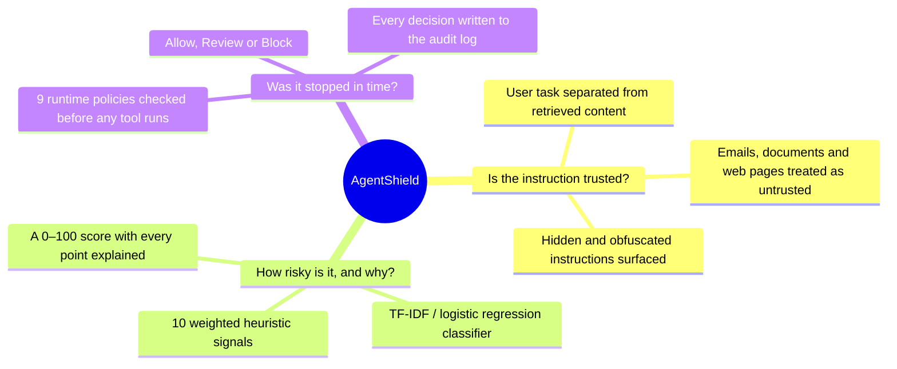
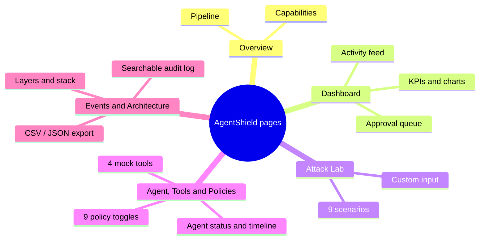

# AgentShield — Prompt Injection & Compromised AI Agent Detection

A hidden instruction is hard to see. AgentShield tells you what an AI agent was asked to do, whether that instruction should be trusted, and whether the tool call was stopped before it ran.

**Try it live:** [agentshield-05.vercel.app/dashboard](https://agentshield-05.vercel.app/dashboard)

**Code:** [github.com/akshithkheeran2008-ctrl/agentshield](https://github.com/akshithkheeran2008-ctrl/agentshield)

| Field | Value |
| --- | --- |
| Title of problem statement | Prompt Injection and Compromised AI Agent Detection |
| Domain | AI in Cybersecurity and Fintech |
| Team name | Zer0-Neuro |
| Event | AVISHKAR'26 — 24 Hour Hackathon, Adichunchanagiri Institute of Technology, Chikkamagaluru |

## The idea in 30 seconds

Banks are adopting AI agents that read documents, emails and web pages, and then call tools such as payment lookups or email drafts. To the model, an instruction hidden inside that content looks like legitimate content. The agent acts quickly and on its own, so a single poisoned email can push it beyond its intended authority.

AgentShield answers three simple questions, for every task:

1. Is this instruction trusted, or did it arrive inside untrusted content?
2. How risky is what the agent is about to do, and why — in points you can read?
3. Was it allowed, sent for review, or blocked before the tool ran?

That is the whole idea. Everything in this app exists to answer those three questions.

```text
Untrusted Input → Detection → Risk Analysis → Policy Evaluation → Agent → Tool Call → Allow / Review / Block → Audit Log → Dashboard
```

> Mock tools and synthetic data only. No real banking or payment APIs. Defensive / detective use only.

## The idea as a mind map



## What happens when you open AgentShield

Start on the product overview. It sets out the protection pipeline and the capabilities, in the same order the engine runs them.

Open the live SOC dashboard. Eight dynamic KPIs, an activity feed, an approval queue and four charts, with Demo Mode and Reset. This is where you watch counters and events change as you run tasks — nothing here is a fixed screenshot.

Run a scenario in the Attack Lab. There are 9 predefined scenarios, plus a custom input box: scan the input, simulate the agent, intercept what it tries to do, evaluate it against policy, and read the decision.

Check the agent itself. Its status — SAFE, WARNING, COMPROMISED or BLOCKED — is shown next to its original goal, the action it proposed, its permissions and a timeline, so a change in behaviour is visible rather than implied.

Inspect the tools and the policies. Four mock tools, with call and block counts for each, and 9 runtime policies you can switch on and off. Turn the policies off and replay an attack to see the agent become COMPROMISED — that contrast is the point of the demo.

Read the audit log. Every event is filterable and searchable, and the log exports to CSV or JSON. The architecture and about pages explain the layers, the stack and the team behind it.

| Route | Purpose |
| --- | --- |
| `/` | Product overview, protection pipeline, capabilities |
| `/dashboard` | Live SOC dashboard: 8 dynamic KPIs, activity feed, approval queue, 4 charts, Demo Mode, Reset |
| `/simulator` | Attack Lab (9 scenarios) plus custom input: scan, simulate agent, intercept, policy, decision |
| `/agent` | Agent status, goal vs proposed action, permissions, timeline |
| `/tools` | 4 mock tools plus unregistered-tool denial, call / block counts, per-tool activity |
| `/policies` | 9 runtime policies with enable / disable toggles, risk-scoring model |
| `/events` | Filterable, searchable audit log with CSV / JSON export |
| `/architecture`, `/about` | Architecture layers, stack, team |

## Everything in the app, in one more mind map



Nine routes, but they all fit under those five branches. If a feature does not help detect an injection, explain a risk score, or stop a tool call, it does not belong in AgentShield.

## Decisions that change with the risk score

The same instruction is not the same risk in every context. A payment lookup a user asked for is ordinary work. The same lookup, ordered by text hidden in a supplier email, is an attack. So AgentShield scores the request first, and lets the score — not the agent — decide what happens next.

| Score | Level | Decision |
| ---: | --- | --- |
| 0–29 | SAFE | ALLOW |
| 30–59 | LOW | REVIEW |
| 60–79 | HIGH | BLOCK |
| 80–100 | CRITICAL | BLOCK |

Each decision tells you three things: the score out of 100, the decision (allow, review or block), and why — signal by signal, with the points each signal added. No decision is just a colour.

Two tool names are treated differently from the rest. `transfer_money` and `approve_payment` are not registered tools at all, so any attempt to call them is always denied, whatever the score says.

## Where the numbers come from

| What | Where it comes from |
| --- | --- |
| Heuristic signals | 10 weighted signals in `data/rules.json`, negation-aware, with zero-width and base64 de-obfuscation |
| Classifier | TF-IDF / logistic regression, in `src/data/model.json`, trained by `backend/train_model.py` |
| Risk score | `score = min(100, Σ signal weights + classifier points)` |
| Policies | P01–P09 in `data/policies.json` |
| Mock tools | `read_file`, `payment_lookup`, `draft_email`, `fetch_web_content` — synthetic data only |

The 9 policies cover untrusted content, payment approval, high-risk confirmation, credentials, unknown tools, parameter validation, goal deviation, data export, and human approval for critical actions.

The same engine exists twice, on purpose. The JavaScript engine in `src/engine/` and the Python engine in `backend/app/engine/` read the same JSON files and produce identical results, so the demo runs fully in the browser and the same logic is available behind the API.

## The API (FastAPI)

`POST /api/scan` · `POST /api/simulation/run` · `POST /api/agent/run` · `POST /api/tool/execute` · `GET /api/events` · `GET /api/dashboard` · `GET /api/tools` · `GET /api/policies` · `POST /api/policies/update` · `POST /api/reset` · `GET /api/health`

Interactive docs are served at `/docs` when the backend is running.

## Honest notes

This is a defensive prototype, not a production banking control. It detects and blocks inside a sandbox; it is not connected to any real account, payment rail or mailbox.

Mock tools and dummy data only. No real payment APIs are called, and no real customer data is used — only public, synthetic or authorised data, as the problem statement requires.

The sandboxed agent is deliberately naive. It obeys instructions in its context, including injected ones, so that the guardrails — not the agent's own judgement — are what provide the safety. That is the behaviour being tested.

Detection must not block normal work. A clean request should score SAFE and be allowed, and the judge flow below includes one on purpose, so a high block rate on attacks is not bought by blocking everything.

Turning every policy off is a supported demo, not a bug. With the policies disabled, replaying an injection shows the agent as COMPROMISED. That is the "without AgentShield" half of the comparison.

## The judge flow, in about three minutes

1. **Dashboard** — note the KPIs and the event feed as they stand.
2. **Attack Simulator → Indirect Prompt Injection** — CRITICAL, 100/100, with the triggered signals listed and their points explained.
3. Watch the agent try `payment_lookup(*)` and `transfer_money`. The policies block the calls, the agent status becomes BLOCKED, and the events and counters update.
4. **Events page** — find the blocked calls in the audit log.
5. **Safe Request** — the same flow on a clean task: SAFE, and ALLOWED.
6. **Policies page** — toggle all policies off and replay the injection to see AGENT COMPROMISED.

## For developers

```bash
# Frontend (repo root) — the full engine runs in-browser
npm install   # install
npm run dev   # run locally — http://localhost:5173
npm run build # production build
npm run preview
```

```bash
# Backend
cd backend && pip install -r requirements.txt
pytest -q                        # engine + API tests
uvicorn app.main:app --reload    # http://localhost:8000/docs

# Route scans through FastAPI instead of the in-browser engine
VITE_API_URL=http://localhost:8000 npm run dev
```

If the FastAPI instance is unreachable, the frontend shows "Security Engine Offline" and falls back rather than failing silently.

Health of the project, honestly: this README does not quote a test count, a coverage figure or a CI status, because the repository does not state them. Run `pytest -q` and `npm run build` yourself for the current state.

## Deploy

Netlify: import the repo and leave the Base directory empty. `netlify.toml` sets the build command to `npm run build`, publishes `dist`, uses Node 20 and adds the SPA fallback. Optionally set `VITE_API_URL` to a hosted FastAPI instance.

Live deployment: [agentshield-05.vercel.app/dashboard](https://agentshield-05.vercel.app/dashboard)

## Licence

No licence file is listed in the repository root, so no licence is claimed here. Check with the team before reusing the code.

Made for banking workflows where an AI agent reads first — and must not act on everything it reads.
